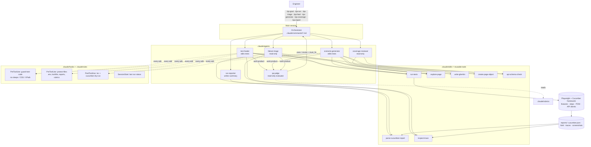

# Agentic QA harness (Claude Code)

The AI layer is a **Claude Code harness** checked into `.claude/`. It needs no extra SDK, API key wiring or runtime service. Open the repo in Claude Code and the orchestrator commands, role agents, skills, hooks, rules and rubrics are available to anyone who clones it. Engineers invoke them when they need them. Nothing runs on its own except the safety hooks.

## Architecture



### Why the orchestrator is a command, not an agent
Claude Code subagents cannot spawn other subagents. So the orchestrator runs in the main session, and its "program" is the prompt in `.claude/commands/qa.md` (and the single-pipeline commands). It plans, delegates to role agents with narrow inputs, and enforces rubric gates. Each role agent gets only the tools its job needs: triage, coverage and the judge are read-only, and only the healer and the generator can edit.

### Generator / evaluator separation
Agents that produce work (generator, healer, triage) never grade themselves. `qa-judge` scores their output against `.claude/rubrics/*.md`:
- the threshold must be met, and no "must" criterion may score 0
- a `revise` verdict loops back with specific `must_fix` items, for at most 2 rounds
- after that, the work escalates to the human

The rubrics are protected: the `protect-files` hook asks a human before any edit.

### Deterministic guardrails beat instructions
Rules tell the agent what to do, and hooks make sure it actually happens:

| Hook | Event | Effect |
|------|-------|--------|
| `guard-test-code.mjs` | PreToolUse Edit/Write | denies `waitForTimeout`/`setTimeout`/`sleep` in `src`/`features`, CSS/XPath locators in `src/pages` and "wait N seconds" steps |
| `protect-files.mjs` | PreToolUse Edit/Write | denies `.env`, the lockfile and `reports/`; asks before rubric edits |
| `post-edit-check.mjs` | PostToolUse Edit/Write | `tsc --noEmit` after `.ts` edits; strict Cucumber dry run after `.feature` edits (undefined/ambiguous steps) and feeds the errors back |
| `session-context.mjs` | SessionStart | injects the last run's pass/fail status and the entry points |

Path-scoped rules in `.claude/rules/` (locators, page objects, Gherkin, API tests, healing policy) load only when Claude works on matching files.

## Skills (tools) and their scripts

| Skill | Script | Purpose |
|-------|--------|---------|
| run-tests | (npm scripts) | choose profile/tag/file/line; env overrides; rerun failures |
| parse-cucumber-report | `scripts/parse-report.ts` | cucumber.json → compact failure JSON with artifact paths |
| inspect-trace | `scripts/trace-summary.ts` | trace.zip → action timeline, failed action, HTTP ≥ 400, console errors |
| explore-page | `scripts/page-snapshot.ts` | live ARIA snapshot + data-test ids (optional login) for locators |
| write-gherkin | `scripts/list-steps.ts` | lists existing step phrases with file:line to maximise reuse |
| create-page-object | n/a | POM template + registration in `PageObjects` |
| api-schema-check | `scripts/schema-drift.ts` | zod schemas vs live OpenAPI spec drift |

## Example sessions (illustrative, abbreviated)

**Run and triage**
```
> /qa-run ui
  ran: npm run test:ui → 7/8 passed
  failure-triage → features/ui/checkout.feature:10  test-bug (high)
     root cause: CheckoutPage.orderConfirmation targets data-test="order-confirmation", but the element only has id="order-confirmation"
     evidence: trace shows expect timed out; screenshot shows "Thanks for your order! … INV-2026000006"
  run-reporter → reports/qa-summary.md
  Suggest: /qa-heal
```

**Heal with a gate**
```
> /qa-heal
  test-healer: getByTestId('order-confirmation') → getByText(/Thanks for your order/); 3/3 green
  qa-judge (healing-fix): 12/12 pass
```

**Generate from the backlog**
```
> /qa-coverage
  REQ-API-04, REQ-UI-04 and REQ-UI-05 are missing; overall 20/26 criteria covered
> /qa-generate REQ-API-04
  scenario-generator: features/api/product-search.feature (3 scenarios, 5 steps reused, 2 new)
  qa-judge (scenario-quality): 18/20 pass
```

## Real catches during development
The checkout scenario was flaky at first. The `inspect-trace` skill (trace summary, then the request and response bodies) found two separate root causes. In both cases the fix followed the healing policy: no sleeps, no retries, no weakened assertions.

1. **A shared profile overwrote the form.**
   - Evidence: `POST /invoices -> 422`, and the request carried an Austrian address with `billing_postal_code: null`, which the test never typed.
   - Cause: the billing step prefills from the demo customer's profile, which anyone on the public instance can edit. That prefill landed after the test had typed its values.
   - Fix: register an isolated customer through the API for each run.
2. **The seeded address disagreed with the app's own address service.**
   - Evidence: `POST /invoices -> 422`, with `"The city does not belong to the selected country."` even for Utrecht, NL.
   - Cause: the backend validates invoices against its `postcode-lookup` service, which deterministically maps NL / 3511 AA / 1 to a generated street and city. Earlier green runs had only passed because the lookup sometimes won a race and replaced the typed city.
   - Fix: seed the customer with the address that `GET /postcode-lookup` returns, then assert that the UI prefills **exactly** that address.

The scenario is now a stronger backend-to-UI sync check, and it has passed repeatedly, including with `PARALLEL=3`.
